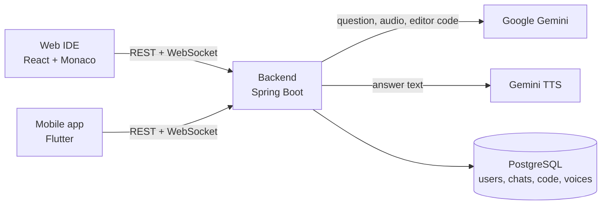

<div align="center">


# Saki AI

**An AI voice coding assistant, fluent in Sinhala and English.**

Ask a programming question by voice or text. Saki explains the answer out loud and writes complete, working code
into your editor.

[](https://saki-ai-blue.vercel.app)


</div>

> [!NOTE]
> **Live demo availability:** the demo is hosted on free-tier infrastructure. After a period of inactivity the server
> goes to sleep, so the first request may take up to a minute while it starts up.

## 📖 Overview

Most AI coding tools expect questions in English. Saki lets Sri Lankan developers ask in **Sinhala, English or
Singlish** (for example, *"Spring Boot වල JWT auth හදන්නේ කොහොමද?"*) and get a clear spoken explanation together with
complete code. It is made up of a Spring Boot backend, a React web IDE and a Flutter mobile app that can act as a
wireless microphone for the web IDE.

## ✨ Features

| | |
| --- | --- |
| **Voice or text** | Ask in Sinhala, English or Singlish: click the mic, press **Alt+S**, or say **"Hey Saki"**. |
| **Spoken answers** | A natural voice reads the answer and its key points. Change the playback speed, download answers as MP3, and replay them later, even after a reload or on another device. |
| **Code in the editor** | Complete code is written into a Monaco editor (the editor used in VS Code). Saki reads your code with every question. |
| **Live answers** | Answers type themselves out, followed by the key points, the voice and the code file. |
| **Phone as a mic** | The Flutter app pairs with the web IDE over WebSockets and stays in sync in real time. |
| **Themes** | Light, dark or match your device, with a smooth transition, plus five chat color themes. |
| **Chat history** | Search, export (Markdown or JSON) or clear your chats from Settings. |
| **Accounts** | Sign in with email and password or with Google. |

## 🧱 Tech stack

| Layer | Technologies |
| --- | --- |
| Backend | Java 21, Spring Boot 3.5, Spring Security with JWT, Spring Data JPA, Flyway, STOMP WebSocket |
| Web IDE | React 19, TypeScript, Vite, Tailwind CSS 4, Monaco Editor, Zustand |
| Mobile app | Flutter, Riverpod, `record`, `just_audio`, `stomp_dart_client` |
| AI | Google Gemini (speech understanding and answers), Gemini TTS (voice), with backup models |
| Database | PostgreSQL 16 |
| Hosting | Vercel (web IDE), Render (backend, Docker), Neon (PostgreSQL) |

## 🏗️ Architecture



1. The client sends the question (a voice recording or text) with the code currently in the editor.
2. Gemini understands the audio directly, detects the language and returns a spoken answer, key points and a code file.
3. The answer is returned immediately; the voice (MP3) follows a few seconds later over the WebSocket and is saved
   with the chat.
4. Every device signed in to the same account and chat updates in real time.

## 🚀 Getting started

### 📋 Prerequisites

- [Docker](https://www.docker.com/) with Docker Compose
- A free [Gemini API key](https://aistudio.google.com/apikey)

### 🐳 Run with Docker

```bash
git clone https://github.com/Mihiran-Thilakarathna/Saki-AI.git
cd Saki-AI
cp .env.example .env
```

Set `GEMINI_API_KEY`, `POSTGRES_PASSWORD` and `JWT_SECRET` in `.env` (see Configuration below), then start
everything:

```bash
docker compose up -d --build
```

Open **http://localhost:8081**, create an account and ask Saki a question.

<details>
<summary><b>Run without Docker</b></summary>

**Backend** (JDK 21, Maven 3.9 and PostgreSQL 16; set the variables from `.env.example`):

```bash
cd saki-backend
mvn spring-boot:run
```

**Web IDE** (Node 22), served at http://localhost:5173:

```bash
cd saki-web
npm install
npm run dev
```

**Mobile app** (Flutter 3.38). Set the backend address under **Server settings** on the login screen:

```bash
cd saki-mobile
flutter pub get
flutter run
```

**Tests and checks:**

```bash
cd saki-backend && mvn test
```
```bash
cd saki-web && npm run typecheck && npm run lint
```

</details>

## ⚙️ Configuration

All settings are environment variables; [`.env.example`](.env.example) lists every option with comments.

| Variable | Required | Description |
| --- | --- | --- |
| `GEMINI_API_KEY` | Yes | Powers both the answers and the voice. |
| `POSTGRES_PASSWORD` | Yes | Database password. |
| `JWT_SECRET` | Yes | Secret for sign-in tokens. Generate with `openssl rand -base64 48`. |
| `GOOGLE_CLIENT_ID` | No | Enables **Sign in with Google**. Leave blank to hide the button. |
| `CORS_ALLOWED_ORIGINS` | No | Web addresses allowed to call the API (the defaults cover local development). |
| `GEMINI_MODEL`, `GEMINI_TTS_MODEL` | No | Override the default Gemini models. |

**Sign in with Google (optional):** in the Google Cloud console, create an OAuth client of type *Web application*,
add your site address (for example `http://localhost:8081`) to **Authorized JavaScript origins**, and put the client ID
in `GOOGLE_CLIENT_ID`. Publish the app under **Google Auth Platform → Audience** so that any Google account can sign in.

## 📁 Project structure

```text
Saki-AI/
├── saki-backend/        Spring Boot API: auth, chats, AI and voice, WebSocket
│   └── src/main/java/com/sakiai/backend/
│       ├── controller/  REST endpoints
│       ├── service/     Chat, AI (Gemini) and text-to-speech logic
│       ├── security/    JWT, Google sign-in, rate limits
│       └── domain/      JPA entities
├── saki-web/            React web IDE (Vite)
│   └── src/
│       ├── components/  UI: sign-in, chat, editor, settings
│       ├── store/       State (Zustand)
│       └── hooks/       Voice recording, WebSocket, wake word
├── saki-mobile/         Flutter mobile app
├── docker-compose.yml   Local stack: PostgreSQL, backend, web IDE
└── render.yaml          Render deployment blueprint
```

## ☁️ Deployment

The live version runs entirely on free plans.

| Part | Platform | Notes |
| --- | --- | --- |
| Web IDE | Vercel | Root directory `saki-web`; set `VITE_API_BASE_URL` to the backend URL. |
| Backend | Render | Docker service created from [`render.yaml`](render.yaml). |
| Database | Neon | PostgreSQL; Flyway creates the schema on start-up. |

After deploying, set the backend's `CORS_ALLOWED_ORIGINS` to the web IDE's URL and add that URL to the Google client's
**Authorized JavaScript origins**.

## 🔒 Security

- Passwords are hashed with BCrypt, and every chat, message and voice is accessible only to its owner.
- Rate limits protect sign-in and the AI from abuse, and oversized requests are rejected.
- The website sends a strict Content-Security-Policy and other secure browser headers.
- Secrets are kept in `.env` (ignored by git) or in the hosting dashboards, never in the code.

See the [Privacy Policy](https://saki-ai-blue.vercel.app/privacy) and
[Terms of Service](https://saki-ai-blue.vercel.app/terms).

## 👤 Author

**Mihiran Thilakarathna**: Information Technology undergraduate at Rajarata University of Sri Lanka, building
full-stack and AI/ML applications.

[](https://mihiran.me)
[](https://www.linkedin.com/in/mihiran-thilakarathna)
[](https://github.com/Mihiran-Thilakarathna)
