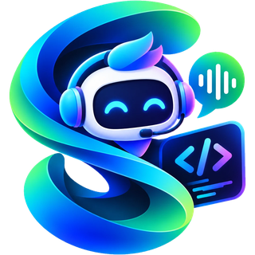
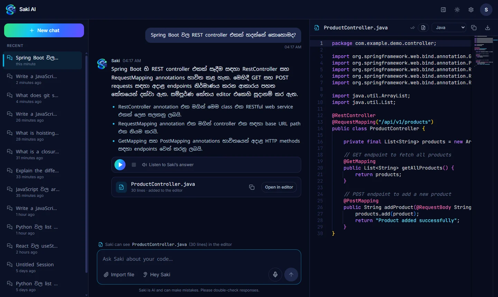
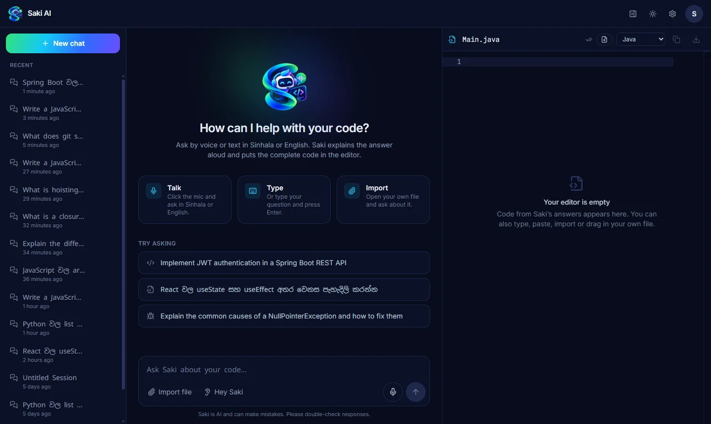
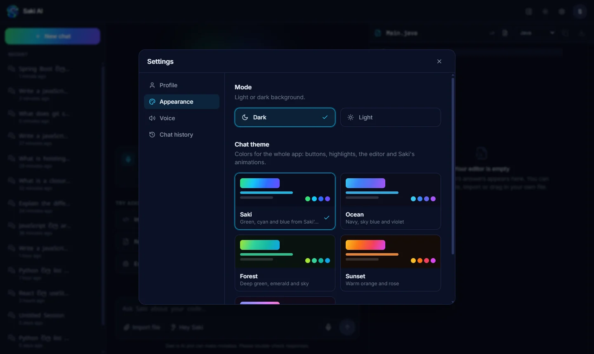
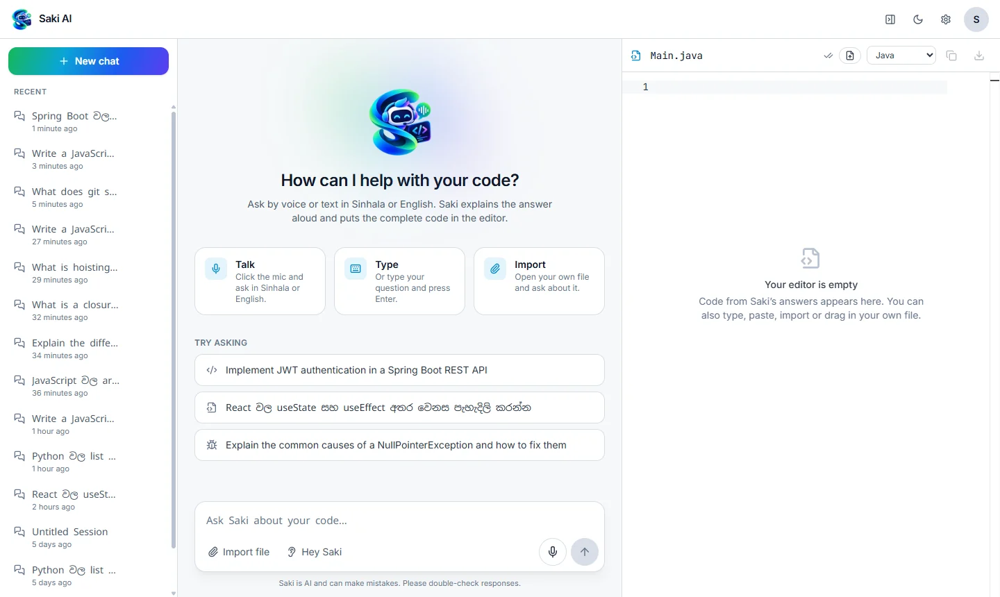
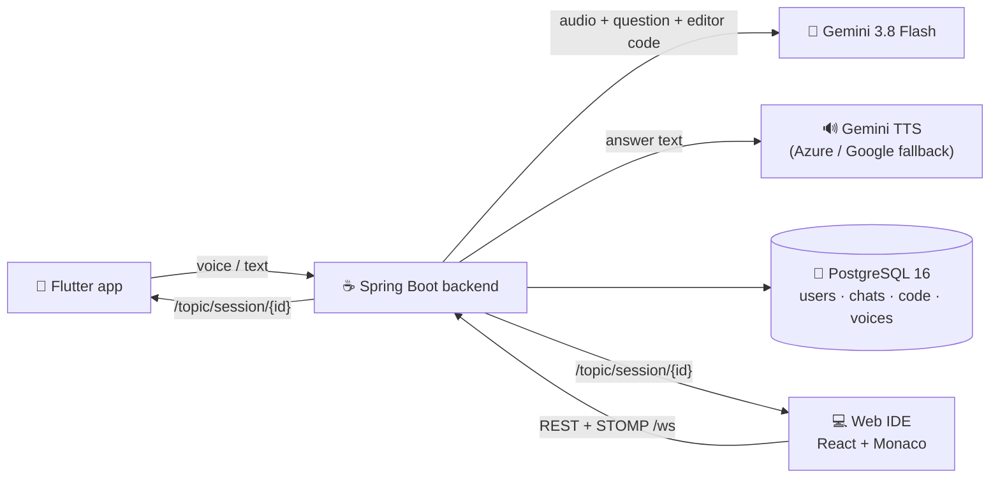

<div align="center">



# Saki AI

### Your bilingual voice coding companion

Ask in **සිංහල, English or Singlish**. Saki explains the answer **out loud** and writes the **complete code** into your editor.

<a href="https://saki-ai-blue.vercel.app"></a>


**[Live demo](https://saki-ai-blue.vercel.app)** · [Features](#-features) · [Quick start](#-quick-start-docker) ·
[Deploy for free](DEPLOY.md) · [API](#-api-reference) · [Security](#-security)

</div>

> [!NOTE]
> The live demo runs on free hosting. After a quiet period the first request can take about a minute while the server
> wakes up (the site shows a "waking up" banner meanwhile).

<br />

<div align="center">
  
</div>

<table>
  <tr>
    <td width="33%"></td>
    <td width="33%"></td>
    <td width="33%"></td>
  </tr>
  <tr>
    <td align="center"><sub>Home screen</sub></td>
    <td align="center"><sub>Settings and chat themes</sub></td>
    <td align="center"><sub>Light mode</sub></td>
  </tr>
</table>

---

## ✨ Features

| | |
| --- | --- |
| 🎙️ **Voice or text, in Sinhala and English** | Talk or type, including Singlish ("Spring Boot වල JWT auth හදන්නේ කොහොමද?"). Click the mic, hold it to talk, press **Alt+S**, or say **"Hey Saki"**. |
| 🔊 **Answers out loud** | A natural neural voice reads the answer and its key points (never the code). Change the playback speed, download any answer as an **MP3**, and play earlier answers again after a reload or on another device. |
| 💻 **Code straight into the editor** | Saki writes the complete, runnable file into a **Monaco** editor (the VS Code editor) with the right language and file name. Edit it, copy it, download it or import your own file; Saki reads the editor with every question. |
| ⌨️ **Answers that type themselves out** | New answers appear word by word, then the explanation points, voice player and code file fade in. |
| 📱 **Phone as a wireless mic** | The Flutter app works on its own or pairs with the Web IDE: ask on the phone, and the code appears on the laptop. Everything stays in sync over WebSockets. |
| 🎨 **Themes** | Light and dark modes and five chat themes (Saki, Ocean, Forest, Sunset, Lavender) that recolor the whole app, the editor included. |
| ⚙️ **Settings** | Profile, appearance, voice (speak aloud, playback speed) and chat history: search, open, **export** (Markdown or JSON) or **clear** all chats. |
| 🔐 **Accounts** | Email and password or **Sign in with Google**. Every visit starts on a fresh chat; earlier chats are in the sidebar. |

---

## 🧭 How it works

One Spring Boot backend serves two clients: a React **Web IDE** and a Flutter **mobile app**.



1. The question (a recording or text) goes to the backend with the code that is open in the editor.
2. **Gemini** hears the audio directly (no separate speech-to-text), detects Sinhala or English, and returns a short spoken
   answer, explanation points and a complete code file.
3. The answer and code are sent back at once; the **voice** (MP3) follows a few seconds later over the WebSocket and is
   saved with the chat.
4. Every device signed in to the same account and chat updates in real time.

| Folder | Stack |
| --- | --- |
| [`saki-backend/`](saki-backend) | Java 21, Spring Boot 3.5, Spring Security + JWT, JPA + Flyway, STOMP WebSocket, virtual threads |
| [`saki-web/`](saki-web) | React 19, TypeScript, Vite, Tailwind CSS 4, Monaco Editor, `@stomp/stompjs`, Zustand |
| [`saki-mobile/`](saki-mobile) | Flutter 3.38 / Dart 3.10, Riverpod 3, `record`, `just_audio`, `speech_to_text`, `stomp_dart_client`, `dio` |
| [`docker-compose.yml`](docker-compose.yml) | PostgreSQL 16 + backend + Web IDE (nginx) |

**Live deployment (all free tiers):** Web IDE on **Vercel**, backend on **Render** (Docker), database on **Neon**
PostgreSQL. The step-by-step guide is in **[DEPLOY.md](DEPLOY.md)**.

---

## 🔑 API keys

Saki needs **only one key: Gemini.** The same key powers Saki's brain *and* voice. Azure and Google text-to-speech are
optional fallbacks.

<details>
<summary><b>Google Gemini (required)</b></summary>

1. Open **[Google AI Studio → API keys](https://aistudio.google.com/apikey)** and sign in.
2. Click **Create API key** (pick or create a Google Cloud project).
3. Put it in `.env` as `GEMINI_API_KEY`. The default model is `gemini-3.8-flash` (`GEMINI_MODEL`), with
   `GEMINI_FALLBACK_MODELS` tried when it is busy. If Saki reports `AI_MODEL_UNAVAILABLE`, set `GEMINI_MODEL` to a current
   model from [the models list](https://ai.google.dev/gemini-api/docs/models).

</details>

<details>
<summary><b>Saki's voice: Gemini TTS (default, no extra setup)</b></summary>

Uses `GEMINI_API_KEY` with `gemini-3.8-flash-tts`. When that model's free daily quota runs out, Saki switches to
`GEMINI_TTS_FALLBACK_MODELS` (default `gemini-3.8-flash-lite-tts`, which has its own quota). Change the voice with
`GEMINI_TTS_SINHALA_VOICE` / `GEMINI_TTS_ENGLISH_VOICE`: `Charon` (default), `Orus`, `Puck` (male) or `Kore`, `Aoede`,
`Leda` (female). The audio is re-encoded to MP3 on the server, so every client plays the same format.

</details>

<details>
<summary><b>Microsoft Azure AI Speech (optional fallback)</b></summary>

1. In the **[Azure portal](https://portal.azure.com)** choose **Create a resource → Speech**.
2. Choose a **region** (e.g. `southeastasia`) and a pricing tier. The free **F0** tier includes a monthly neural-TTS
   allowance.
3. Open the resource → **Keys and Endpoint**. Copy **KEY 1** into `AZURE_SPEECH_KEY` and the region into
   `AZURE_SPEECH_REGION`.
4. Voices: `si-LK-SameeraNeural` (default) / `si-LK-ThiliniNeural`, and `en-US-AvaNeural` / `en-US-AndrewNeural`.

</details>

<details>
<summary><b>Google Cloud Text-to-Speech (optional fallback)</b></summary>

1. In the **[Google Cloud console](https://console.cloud.google.com/)** enable **Cloud Text-to-Speech API**.
2. **APIs & Services → Credentials → Create credentials → API key**; restrict it to the Text-to-Speech API.
3. Set `GOOGLE_TTS_API_KEY`. Sinhala is only used if you set `GOOGLE_SINHALA_VOICE` to a voice your project can use.

</details>

<details>
<summary><b>Sign in with Google (optional)</b></summary>

One **Web application** OAuth client serves the Web IDE and the Android app.

1. **[Google Cloud console](https://console.cloud.google.com/) → Google Auth Platform**: fill in **Branding** (app name,
   support email, home page, privacy policy `/privacy` and terms `/terms` links, authorized domain), then under
   **Audience** choose **External** and **Publish app** so anyone can sign in (while in *Testing*, only test users can).
2. **Clients → Create client → Web application.** Under **Authorized JavaScript origins** add `http://localhost:5173`,
   `http://localhost:8081` and your live URL. Copy the client ID into `GOOGLE_CLIENT_ID`.
3. For the **Android app**, also create an **Android** client with package `com.sakiai.saki_mobile` and the SHA-1 of the
   keystore that signs the APK. For debug builds:
   ```bash
   keytool -list -v -alias androiddebugkey -keystore ~/.android/debug.keystore -storepass android -keypass android
   ```

The backend verifies every Google ID token (signature, issuer, audience, expiry, verified email). When
`GOOGLE_CLIENT_ID` is blank the Google buttons are hidden.

</details>

<details>
<summary><b>JWT secret</b></summary>

```bash
openssl rand -base64 48
```
Put the output in `JWT_SECRET` (it must decode to at least 32 bytes).

</details>

---

## 🚀 Quick start (Docker)

Requires Docker Desktop (or Docker Engine + Compose v2).

```bash
cp .env.example .env
```
Edit `.env`: set at least `POSTGRES_PASSWORD`, `JWT_SECRET` and `GEMINI_API_KEY`.

```bash
docker compose up -d --build
```

| Service | URL |
| --- | --- |
| Web IDE | http://localhost:8081 |
| Backend API | http://localhost:8080 (health: `/actuator/health`) |
| PostgreSQL | `localhost:5432` (bound to 127.0.0.1 only) |

Open the Web IDE, create an account, click the mic (or press **Alt+S**) and ask a question. Flyway creates the database
schema on first start.

```bash
docker compose logs -f backend
```
```bash
docker compose down
```
(`docker compose down -v` also deletes the database volume.)

---

## 🛠️ Local development

<details open>
<summary><b>Backend: <code>saki-backend</code></b></summary>

Needs JDK 21+ and Maven 3.9+, plus PostgreSQL 16. You can run just the database from Compose:

```bash
docker compose up -d postgres
```

Set the variables from `.env.example` (`DB_URL`, `DB_USERNAME`, `DB_PASSWORD`, `JWT_SECRET`, `GEMINI_API_KEY`, …), then:

```bash
cd saki-backend
mvn spring-boot:run
```

Tests: unit tests, full-context tests on H2, and the Flyway schema on a real embedded PostgreSQL 16 (no keys or Docker
needed):
```bash
mvn test
```

</details>

<details open>
<summary><b>Web IDE: <code>saki-web</code></b></summary>

Needs Node 22+. The Vite dev server proxies `/api` and `/ws` to `http://localhost:8080` (change with
`SAKI_BACKEND_URL`).

```bash
cd saki-web
npm install
npm run dev
```
Open http://localhost:5173. Other scripts: `npm run build`, `npm run typecheck`, `npm run lint`.

</details>

<details open>
<summary><b>Mobile app: <code>saki-mobile</code></b></summary>

Needs Flutter 3.38+ and, for Android, the Android SDK (platform 36 and NDK 27.x).

```bash
cd saki-mobile
flutter pub get
flutter run
```

Set the backend address under **Server settings** on the login screen:

| Where the app runs | Backend URL |
| --- | --- |
| Android emulator | `http://10.0.2.2:8080` (default) |
| iOS simulator / web | `http://localhost:8080` |
| Real phone | `http://<your-laptop-Wi-Fi-IP>:8080`, e.g. `http://192.168.1.20:8080` |
| Live backend | `https://saki-backend-89us.onrender.com` |

Or bake it in: `flutter run --dart-define=SAKI_API_URL=http://192.168.1.20:8080`. Build an APK:
```bash
flutter build apk --release
```

</details>

---

## 💬 Using Saki

**Web IDE**
- **Mic:** click to start or stop, **hold** for push-to-talk, **Alt+S** from anywhere, **Esc** cancels.
- **"Hey Saki":** toggle the ear button for hands-free questions (Chrome and Edge).
- **Voice player:** under each answer: play, pause, stop, seek and download (MP3). Set the speed in **Settings → Voice**.
- **Editor:** code from Saki lands in Monaco (undo with Ctrl+Z). Your edits are saved with the chat and sent as context
  with the next question. Drop a file anywhere on the page, or use **Import file**.
- **Settings** (gear icon or account menu): profile, light/dark mode, chat theme, voice options, and chat history
  (search, export as Markdown or JSON, clear).

**Mobile app**
- **Standalone:** ask on the phone, hear the answer, read highlighted code (tap a code card for full screen, copy).
- **Web IDE mic:** sign in with the **same account**, pick the chat that is open on your laptop and talk. The code
  appears in the laptop's editor and the laptop speaks the answer.

Each client sends a per-device `clientId`; the backend echoes it as `originClientId`, so the asking device ignores its
own WebSocket echo while every other device updates.

---

## 📚 API reference

All endpoints except register, login and providers need `Authorization: Bearer <token>`. Errors are RFC 9457
`ProblemDetail` JSON with an `errorCode` (e.g. `AI_NOT_CONFIGURED`, `UNSUPPORTED_AUDIO_FORMAT`, `EMAIL_IN_USE`).

| Method | Path | Notes |
| --- | --- | --- |
| POST | `/api/v1/auth/register` | `{fullName, email, password, preferredLanguage: "si-LK" \| "en-US"}` |
| POST | `/api/v1/auth/login` | `{email, password}` → `{accessToken, tokenType, expiresIn, user}` |
| POST | `/api/v1/auth/google` | `{idToken, preferredLanguage?}` (Google ID token) → same as login |
| GET | `/api/v1/auth/providers` | Public: `{googleEnabled, googleClientId}` |
| GET | `/api/v1/auth/me` | Current profile |
| GET / POST / DELETE | `/api/v1/sessions` | List / create chats / **delete all** chats |
| GET / PATCH / DELETE | `/api/v1/sessions/{id}` | Read, rename or save editor code, delete |
| GET | `/api/v1/sessions/{id}/messages` | Conversation and code history (`hasAudio` marks answers with a saved voice) |
| GET | `/api/v1/sessions/{id}/messages/{messageId}/audio` | The saved voice of an answer (`audio/mpeg`) |
| POST | `/api/v1/saki/voice-query` | multipart: `audioFile`, `sessionId`, optional `currentEditorCode`, `programmingLanguage`, `clientId` |
| POST | `/api/v1/saki/text-query` | JSON: `{sessionId, query, currentEditorCode?, programmingLanguage?, clientId?}` |
| POST | `/api/v1/saki/sessions/{id}/messages/{messageId}/voice` | The saved voice, or a new one for an answer that has none |

Accepted audio: webm/opus (browsers), wav (Flutter app), mp3, aac/m4a, ogg, flac, up to 15 MB.

**WebSocket (STOMP):** connect to `/ws` (native) or `/ws/sockjs` with header `Authorization: Bearer <token>`.

| Topic | Payload |
| --- | --- |
| `/topic/session/{sessionId}` | Every Saki answer (`SakiResponseDto`) |
| `/topic/session/{sessionId}/events` | `PROCESSING` / `COMPLETED` / `FAILED` ("Saki is thinking…") |
| `/topic/session/{sessionId}/audio` | The voice for an answer sent with `audioPending: true` (`audioBase64` is null if TTS failed) |

By default (`TTS_ASYNC_AUDIO=true`) the HTTP response carries the text and code as soon as Gemini answers, and the MP3
follows on the audio topic. Set `TTS_ASYNC_AUDIO=false` to get the audio inside the HTTP response instead.
Subscriptions are only allowed for chats you own.

<details>
<summary><b>Response shape (<code>SakiResponseDto</code>)</b></summary>

```json
{
  "sessionId": "…", "messageId": "…",
  "userTranscript": "Hey Saki, Spring Boot වල JWT auth හදන්නේ කොහොමද?",
  "detectedLanguage": "si-LK",
  "spokenResponse": "හරි යාළුවා! … editor එකේ බලන්න.",
  "audioBase64": null, "audioMimeType": null, "audioPending": true,
  "codePayload": { "hasCode": true, "programmingLanguage": "java", "fileName": "JwtAuthenticationFilter.java",
                   "code": "…", "explanationMarkdown": "- …" },
  "timestamp": "2026-10-18T12:00:00Z", "originClientId": "web-…"
}
```

</details>

---

## 🔒 Security

- **SQL injection:** all database access goes through Spring Data JPA (parameterized queries).
- **Data isolation:** every chat, message, code and voice read or write checks that the chat belongs to the signed-in
  user; WebSocket subscriptions are checked the same way. Other users' chats return 404, so they cannot be discovered.
- **Accounts:** passwords are hashed with BCrypt (cost 12), and login timing does not reveal which emails exist. Google
  sign-in never merges into an existing password account, which prevents account pre-hijacking.
- **Abuse limits** (per client IP for sign-in, per user for everything else), set with environment variables:

  | Variable | Default |
  | --- | --- |
  | `RATE_LIMIT_AUTH_PER_MINUTE` | 10 login / sign-up / Google attempts per IP |
  | `RATE_LIMIT_AI_PER_MINUTE` / `RATE_LIMIT_AI_PER_DAY` | 12 / 200 questions (and voice requests) per user |
  | `RATE_LIMIT_WRITES_PER_MINUTE` | 60 chat changes per user |

  JSON bodies over 1 MB are refused, and client IPs come from the reverse proxy (`X-Forwarded-For` cannot be spoofed).
- **Errors** never include stack traces or exception text.
- **Browser headers** (Vercel and the Docker nginx): a strict Content-Security-Policy, `X-Frame-Options: DENY`,
  `nosniff`, a strict referrer policy, and a Permissions-Policy that allows the microphone for this site only.
- **Secrets** live only in `.env` (git-ignored) or the hosting dashboards.
- **Privacy:** see the [Privacy Policy](https://saki-ai-blue.vercel.app/privacy) and
  [Terms of Service](https://saki-ai-blue.vercel.app/terms).

---

## 🧩 Troubleshooting

| Problem | Fix |
| --- | --- |
| First request is slow on the live site | The free backend sleeps when idle; it wakes up in about a minute. |
| "Too many requests" (`RATE_LIMITED`, 429) | An abuse limit was hit; wait the seconds in `Retry-After`, or raise the `RATE_LIMIT_*` values. |
| `AI_NOT_CONFIGURED` (503) | Set `GEMINI_API_KEY` and restart the backend. |
| "Saki has used up its Gemini API quota" (`AI_QUOTA_EXCEEDED`) | The free daily quota of the Gemini key is used up; it resets daily. |
| "Saki's AI service is busy right now" | Google's model is under heavy demand. Saki already tries `GEMINI_FALLBACK_MODELS`; ask again in a moment. |
| `AI_MODEL_UNAVAILABLE` (503) | Google retired that model for your key; set `GEMINI_MODEL` to a current one. |
| "Saki's voice isn't available right now" | Every voice model is out of quota or failing. The text and code still work; press Play again later. Check the backend log (`Gemini TTS model … failed with 429`). |
| Google sign-in: `origin_mismatch` / "origin is not allowed" | Add the exact site URL to **Authorized JavaScript origins**; changes can take a few minutes. |
| Google sign-in only works for some accounts | The app is still in *Testing*: publish it under **Google Auth Platform → Audience**. |
| Google sign-in: "An account with this email already exists" | That email signed up with a password; sign in with the password instead. |
| Google button missing | `GOOGLE_CLIENT_ID` is blank, or the backend was not restarted after setting it. |
| Android: "Google sign-in is not set up for this app build" | Create the **Android** OAuth client with package `com.sakiai.saki_mobile` and the SHA-1 of the signing keystore. |
| Web IDE mic does nothing on another PC | Browsers only allow the mic on `https://` or `localhost`. Use the live site or the phone app. |
| "Hey Saki" toggle disabled (web) | Needs Chrome or Edge (Web Speech API). Push-to-talk works everywhere. |
| Phone: "Cannot reach the Saki backend" | Use the laptop's Wi-Fi IP (not `localhost`), the same network, and allow port 8080 through the firewall. |
| Phone answers don't appear on the laptop | Use the same account and the same chat on both. |
| Android build: `NDK not configured` / missing `android-35` | Install NDK `27.1.12297006` and SDK platform 36 in Android Studio → SDK Manager, or edit the versions in `android/build.gradle.kts`. |

---

<div align="center">

Made in Sri Lanka 🇱🇰 for developers who think in සිංහල and code in English.

**[Try Saki AI →](https://saki-ai-blue.vercel.app)**

</div>
